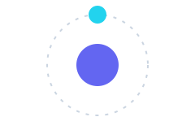

# SVG MOTION

An agent-native SVG animation studio where you describe motion and the agent creates it. Built on the Agent Native framework with real-time collaboration, durable state, and timeline-based animation editing.

**SVG MOTION** transforms natural language descriptions into professional SVG animations. The agent draws the SVG and writes the keyframes — you shape the timing on the timeline.

## Features

- AI-Powered Animation: Describe any animation and watch the agent create it
- Timeline Editor: Zoom, pan, frame stepping, snapping, and multi-keyframe editing with easing controls
- Precision Tools: Transform, node editing, align, distribute, and snap to frames, keyframes, and clip edges
- Drawing Tools: Pen tool, shapes (rectangles, circles, stars), and text
- Image Support: Drag-and-drop images with smart positioning
- Layer Management: Full layer control with bring to front/send to back
- Element Tagging: Right-click elements or groups to tag several of them as chips in one agent prompt
- SVG Export: Export standalone animated SVG files
- Real-time Sync: Changes sync instantly across all sessions
- Auto-save: All projects saved automatically


## Run this project

Requirements: Node.js 22+ and pnpm (`corepack enable`).

```bash
pnpm install
cp .env.example .env
# .env.example enables demo mode, so there is no login wall.
pnpm dev
```

Open the URL printed by Vite (default `http://localhost:8082`); `/` goes
straight to the project launcher. If the agent needs a model that is not
already available, connect an AI provider in Settings -> Agent.

## Production

Production needs a persistent Postgres database:

```bash
DATABASE_URL=postgres://...
```

For a production deployment with authentication enabled, also set:

```bash
BETTER_AUTH_SECRET=<openssl rand -hex 32>
```

`netlify.toml` maps `NETLIFY_DATABASE_URL` to `DATABASE_URL` and runs
migrations on production deploys. Then run `pnpm build` and `pnpm start`, or
deploy with Netlify / Vercel.

### Hackathon demo (no login required)

This build is designed to be tried without creating an account:

- The app opens straight into the project launcher (`/` redirects to `/home`).
- Saved projects live in the browser (`localStorage`, key
  `motion-studio-projects:v1`), so no server-side user data is stored.
- Postgres is only a short-lived scratchpad for the agent. The
  `purge-ephemeral-data` action can delete rows older than 24 hours.

For Vercel, set only:

```bash
DATABASE_URL=postgres://...   # any free hosted Postgres (Neon/Supabase)
```

`BETTER_AUTH_SECRET` is optional while auth is disabled. Let the build run
`pnpm migrate:production`; it creates the framework tables in that database.
No project data needs to be imported — users create their own library in their
browser.

## Quick Start

1. Describe it: Use the prompt composer to describe an animation
2. Watch it move: The agent creates the SVG and animation tracks
3. Shape it: Edit keyframes on the timeline to perfect your timing
4. Export it: Download a standalone animated SVG file

## Example outcomes

A few animations produced by the studio (each is a standalone animated SVG
export — open the file to see it move):

| Loading dots | Heartbeat | Orbit |
| :---: | :---: | :---: |
|  |  |  |

| Spinner | Sticker pop | Bounce |
| :---: | :---: | :---: |
|  |  |  |

## Contact

- Creator: suvo
- Email: suvo.uio@gmail.com
- Repository: https://github.com/suvo-sos/motion

## License

This project is open source and released under the [MIT License](./LICENSE).
Anyone is free to use, modify, and distribute it.
Full docs: [agent-native.com/docs](https://agent-native.com/docs?utm_source=github&utm_medium=referral)
